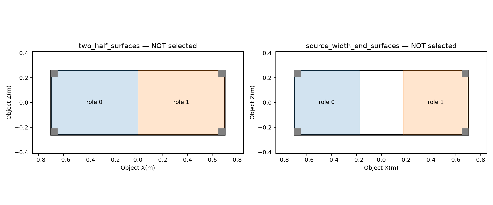
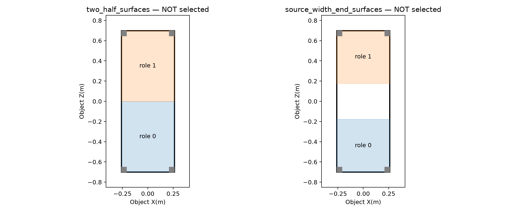

# Ubuntu 离线参考几何试验：第一批交付（2026-10-17）

请先阅读 [中文完整报告](reference_geometry_pilot_20261017/README_CN.md)。对应任务是 [原始执行指引](ubuntu_reference_geometry_pilot_20261017.md)。

## 结果与待决定事项

- 正式 Push/Pull 源参考、模型和采样频率已核对，源文件哈希与指引相符。
- 8 项程序测试通过，真实 G1 镜像 FK/手部网格检查完成；旧 Pull 配对及 runtime 数值完全复现。
- 两例状态均为 **`needs_role_regions`**。连续宽桌不能唯一给出两角色的有限桌面区域，目前没有选定新配对参考，也没有算法改进/成功率结论。
- Push 存在原始手部穿模和桌面上下表面邻近；Pull attempt 8 两手涉及同一条桌腿，但整段还涉及桌面边缘，不能静默删掉这些窗口而只拟合桌腿。
- 未启动训练或物理步进，未修改奖励、正式参考和论文结果表。

请作者/Mac 根据下图确认目标桌面区域：按目标对称面二等分，或在目标两端各取源桌实际宽度，或另给明确边界。图中区域均为提案，尚未选择或评估，不是已经求出的机器人位移。

### Push：物体 X 方向加宽



### Pull：物体 Z 方向加宽



Pull 还需明确：继续保留完整桌面+桌腿窗口共同拟合（当前规格），还是批准另一个仅以桌腿拟合、桌面关系用于验证的设定。当前没有擅自更改规格。

## 完整材料下载

- [完整交付包（约 24 MiB，点击后 Download raw file）](../../paper_handoff_exports/reference_geometry_pilot_20261017.tar.gz)
- [SHA256 文件](../../paper_handoff_exports/reference_geometry_pilot_20261017.tar.gz.sha256)

压缩包 SHA256：

```text
c07d265c5fc4875d73a57520befc394d5e213b3b0d61bd0978afe656fc42d3dd
```

包内有 106 个带校验的文件：源/目标几何及输入清单、完整候选交互窗口、逐帧距离、程序与真实 FK 检查、旧参考复现、4 段完整参考回放、44 张 PNG（36 张真实模型渲染及 8 张曲线/区域图）、原型代码快照/补丁及复现命令。没有 checkpoint、数据集整包或环境。

注意：这些视频是源参考/旧双人参考诊断，不是训练结果，也不是新版候选。完整原型代码在包内 `code_snapshot/`；本次发布没有将实验脚本直接集成进 main 的执行路径。

## 给 Mac 的继续工作指引

1. 拉取 main，阅读本文件及中文报告；下载解压材料并核对 SHA256。
2. 对照源窗口、真实几何与候选区域图，向作者说明并确定有限区域/部件关系。
3. 将确定的边界、角色奇偶性及全部源窗口保留规则交给 Ubuntu；不要把旧间距当作新方法输入。
4. Ubuntu 随后继续完整对应、配准、双角色几何验收和新参考导出。没有这些结果前，不将试验写成优于旧方法。

本发布仅追加交接材料；保留 main 既有内容，不合并整个 core4d-base 工作树、不带入其他未提交实验或文档修改。
