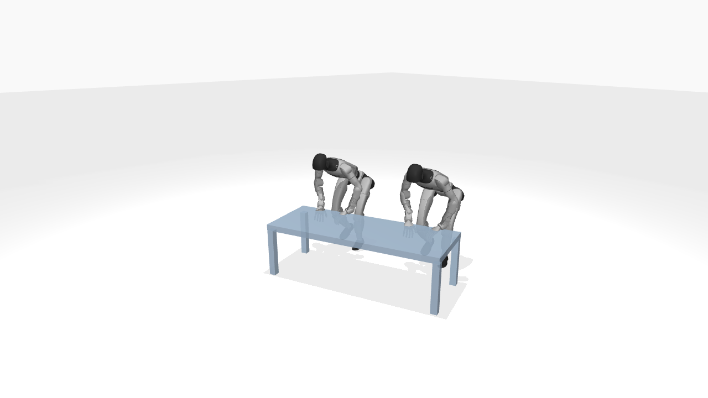
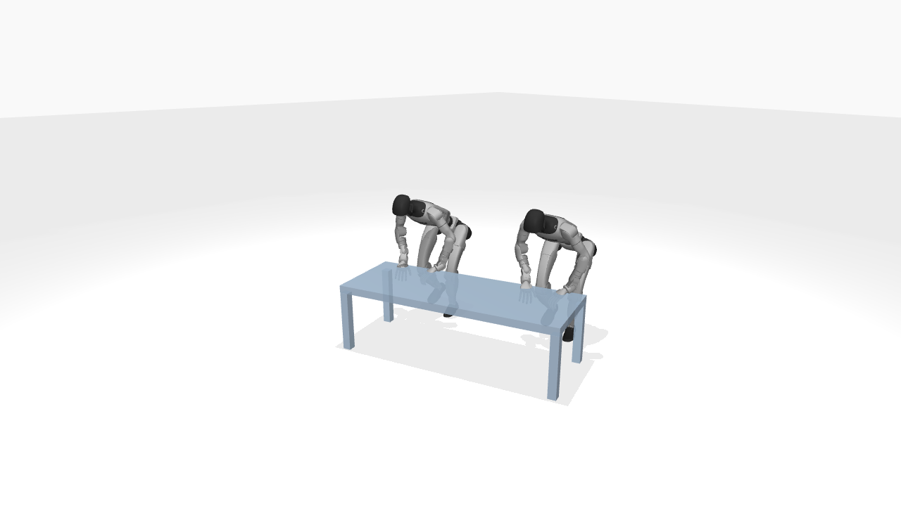
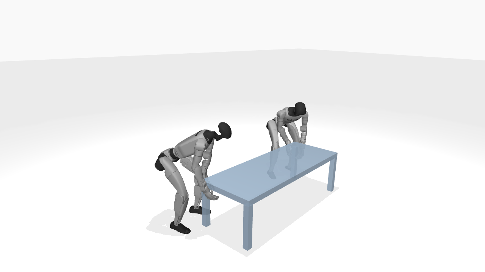

# Ubuntu 第二轮交付：有限区域配准与离线参考验收

已执行 [第二轮指引](ubuntu_reference_geometry_round2_20261017.md)。请先阅读 [完整中文报告](reference_geometry_round2_20261017/README_CN.md)，再查看 [汇总 CSV](reference_geometry_round2_20261017/summary.csv)。

## 本轮结论

| 案例 | 对应与导出 | 验收状态 | 新旧关系 |
|---|---|---|---|
| Push | 完整窗口对应；6×6 个角色组合；已导出诊断参考/runtime | `diagnostic_only`：源支撑脚漂移筛查未通过 | 两侧从 ±0.400 m 改为 ±0.4390236 m；单机器人位移差 39.0236 mm，关节/根部姿态不变 |
| Pull | 完整桌面+桌腿窗口；2×2 个组合；1 组通过，已导出参考/runtime | `passes_source_relative_geometry` | 由几何对应恢复旧参考；根部位置差约 1e−15 m、runtime 最大通道差约 2.91e−14，关节差 0 |

这里的 Pull “通过”是相对既有源参考的几何筛查，不是绝对无穿模或动力学可行证明。已有源运输后的脚部绝对高度问题与 OBB 代理误报均在报告中具体列出。没有训练、策略复评或物理步进，不报告学习收益。

Push 旧版同样存在源相对脚漂移：最大新增支撑漂移约 31.13 mm，新版约 34.41 mm。不能把它描述为新方法独有的退化，更不能据此宣称方法无解。其成因是物体局部固定偏移随物体旋转而在世界坐标变化。

## 同帧同机位诊断图

PNG 不叠帧号；以下帧号均为原 50 Hz 参考的 0-based 索引。完整视频及双方手部特写在交付包。

Push，第 117 帧，旧版 / 新版（新版仅为诊断参考）：




Pull，第 150 帧，旧版 / 新版（几何恢复旧参考）：




## 完整资料

- [交付包，约 29 MiB（Download raw file）](../../paper_handoff_exports/reference_geometry_round2_20261017.tar.gz)
- [压缩包 SHA256](../../paper_handoff_exports/reference_geometry_round2_20261017.tar.gz.sha256)

```text
9860f23fb62fb5b446c5959d38343b474b9457760cdf9797fba8ebe88b3f3a12
```

包内 253 个带校验文件，包含：最终对应/去重权重、全部候选与筛选理由、Q/c、旧/新参考及 runtime、逐帧差值、确定面与边缘集合分开的评测、4 段完整 MP4、60 张同机位渲染 PNG、独立原型代码/补丁与复现命令。无 checkpoint、整套环境或数据集。

## 给 Mac 的说明

1. 本轮无需再选区域，已用作者确认的两端源等宽区域。
2. Pull 已验证完整交互结构能恢复旧构造；这可以作为几何求参的证据，不是成功率提升的证据。
3. Push 的诊断输出可用于讨论支撑一致性；旧版也未通过这套 v0 支撑筛查，报告包含全部连续数值及严格阈值，不能仅用 pass/fail 定论。
4. 本轮离线工作结束。后续是否修正支撑、接受现有漂移或做策略闭环验证，由作者另行决定；不要自动启动训练或改论文结果表。

本次仅追加交接材料，没有合并实验分支或将独立原型脚本接入正式训练路径。
